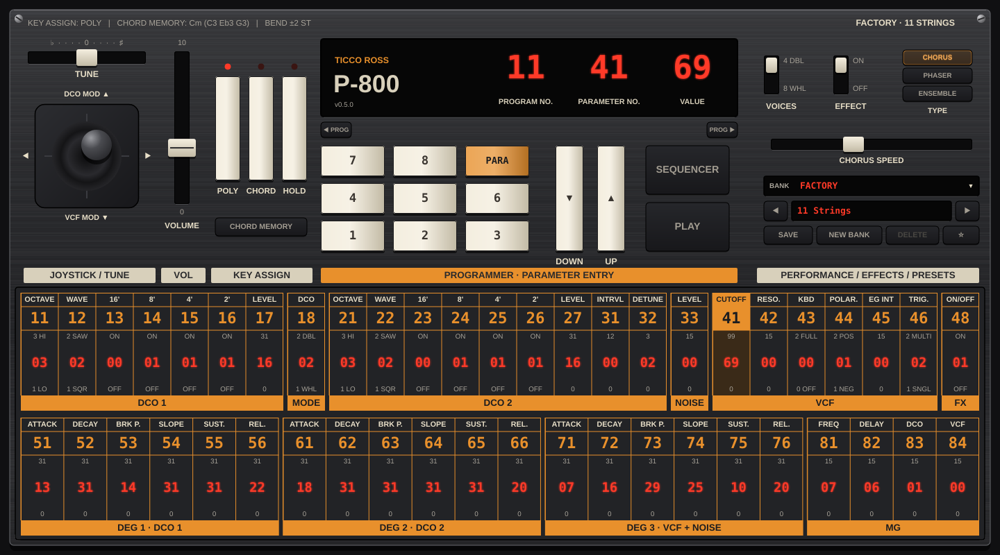

# P-800

AU / VST3 instrument by Ticco Ross, built on the ISLA Poly-800 synthesis core
(`../src`). GPL-3.0-or-later, like the core.

## Status: 0.5.0



- All 47 stock Poly-800 sound parameters (P11–P84) exposed as host parameters,
  named by their original numbers.
- The 64 MkI factory programs as host programs, and as the built-in **Factory**
  bank of the preset manager (`Source/PresetManager.*`, based on Polytwelve's):
  user banks are folders of `.p800preset` files, plus a Favourites bank; save,
  delete, new/delete bank, previous/next, open file, and keypad loading by
  hardware number (11..88) within the bank shown.
- Volume and Tune.
- Hardware-style panel (resizable, fixed aspect): brushed metal, LED display,
  keypad (two digits pick a parameter, or a program in PROG mode), UP/DOWN,
  joystick (springs back), volume fader, tune slider, VOICES and CHORUS
  switches, and the full parameter chart (click to select, drag or scroll to
  change). Everything is a host parameter, so automation and presets follow.
- Key assign: POLY or CHORD, plus HOLD (sustain pedal = HOLD). CHORD is the chord
  memory ported from Polytwelve (`Source/KeyLayer.h`): hold 2+ keys and press
  CHORD (or CHORD MEMORY) to store them; each key then plays the chord
  transposed, last-note priority, up to the voice count (8 WHOLE / 4 DOUBLE).
- Effects, the same as Polytwelve (`Source/PolyEffects.h`, ported unchanged):
  P48 on/off; **Effect Type** picks Chorus (default), Phaser or Ensemble;
  **Effect Speed** sets the chorus/phaser rate or ensemble intensity. The core's
  own BBD chorus is no longer used.
- Joystick, as host parameters (automatable; the panel joystick will drive them):
  - **Joystick X** bends pitch by ±**Bend Range** semitones (1–12, default 2),
    smoothed over ~5 ms.
  - **Joystick Y up** adds the MG triangle to the DCOs (vibrato), **Y down**
    adds it to the VCF, on top of the program's P83/P84, up to full depth.
- MIDI pitch wheel adds to Joystick X; mod wheel (CC1) acts like joystick up.
- **Step sequencer** (`Source/Sequencer.h`): SEQUENCER swaps the chart for the
  sequencer screen, PLAY/STOP runs it. 16 or 32 steps, 8 patterns, polyphonic
  (8 notes per step), rate/swing/gate, host sync or internal BPM, per-step
  probability and gate, parameter locks on any chart parameter (several per
  step), keyboard recording (step and live), copy/paste/clear. Patterns are
  saved in presets and with the session.
- Buttons: backlit-rubber style throughout.

## Core additions

`src/poly800_core.h` gains `poly800_core_set_pitch_bend()` and
`poly800_core_set_joystick_mod()`. They only add performance inputs; with the
joystick centred the core output is unchanged, and the original core tests
still pass. Joystick MG uses the same ROM fixed-point depth law as P83/P84.

- **Noise level fix (0.4.0):** noise joined the mixer without the 8x
  oscillator bus gain, so P33 = 15 was ~19 dB below one voice and inaudible
  under any note. It now takes the same gain (`src/poly800_core_m6.c`).
- **Keyboard tracking fix (0.3.0):** the Bristol-derived filter replaced the
  cutoff with 4 x note frequency x P41 when P43 was on, so P41 hardly did
  anything on 42 of the 64 factory programs. P43 now scales the normal cutoff by
  the highest note's distance from middle C (`src/poly800_core_m2.inc`).

## Wrapper notes (things the core does that the wrapper handles)

- **The core adds into its output buffers** (`+=`) rather than overwriting.
  `Engine` always clears before rendering.
- **The core is only stable on its ≥88 kHz filter path.** Below 88 kHz it uses a
  Bristol 2x branch that self-oscillates ~200x too loud at full resonance
  (factory program 88 "UFO Swoop" blows up). `Engine` therefore runs the core at
  2x the host rate (88.2/96 kHz) at 44.1/48 kHz hosts and decimates with a
  95-tap FIR, so every host rate uses the validated path and sounds the same.
- **The core's output is hot.** Volume maps to `master_gain = volume × 0.15`;
  the default (0.35) puts a 4-note chord on the loudest factory program at
  about 0 dBFS.

## Build

macOS (AU + VST3):

```sh
python3 plugin/tools/gen_factory_header.py   # only if factory/*.csv changed
cmake -S plugin -B plugin/build -G Xcode -DCMAKE_OSX_ARCHITECTURES="arm64;x86_64"
cmake --build plugin/build --config Release
ctest --test-dir plugin/build -C Release --output-on-failure
```

JUCE 8.0.4 is fetched automatically, or pass `-DJUCE_DIR=/path/to/JUCE`.
Plugins land in `plugin/build/P800_artefacts/Release/`.

GitHub Actions (`.github/workflows/poly800-macos.yml`) builds a universal
binary, runs the factory test and uploads an unsigned `.pkg` (plus any PDF in
`plugin/docs/`).

## Manual

`docs/P-800 Manual.pdf` is generated by `tools/make_manual.py` (reportlab) and
ships next to the `.pkg` in every build. Re-run it after changing the panel or
parameters.

## Panel preview

`tools/render_panel.cpp` draws the panel to a PNG without a host (it only needs
juce_core, juce_events and juce_graphics); `docs/panel.png` comes from it.

## Tests

`tests/sequencer_test.cpp` checks editing rules, timing (internal and host
sync, loops), swing, gate, chords, 32 steps, probability, locks and the save
format. `tests/seq_engine_test.cpp` plays patterns through the synth engine and
checks that steps sound, go silent, and that a cutoff lock changes the sound.

`tests/preset_test.cpp` checks banks, save/load, overwrite, numbering,
previous/next, favourites, deleting and opening files (temporary folder).

`tests/filter_test.cpp` checks that P41 sweeps the filter at every P43/P45
setting, that tracking opens the filter on higher notes, and that P33 noise
is audible.

`tests/effects_test.cpp` checks Chorus, Phaser and Ensemble for level, stereo
and speed, and that P48 off is dry.

`tests/chord_test.cpp` checks POLY, CHORD memory (capture, transposition,
last-note priority, voice limit, MEMORY button) and HOLD.

`tests/joystick_test.cpp` checks that bend moves pitch by exactly the requested
interval and that joystick up/down modulate pitch/filter (and centred does
nothing), at 48 and 96 kHz.

`tests/factory_render_test.cpp` renders a chord through all 64 factory
programs at 44.1, 48 and 96 kHz through the same `Engine` and parameter
mapping the plugin uses, and checks for finite, audible, non-clipping output
with matching levels across sample rates.
